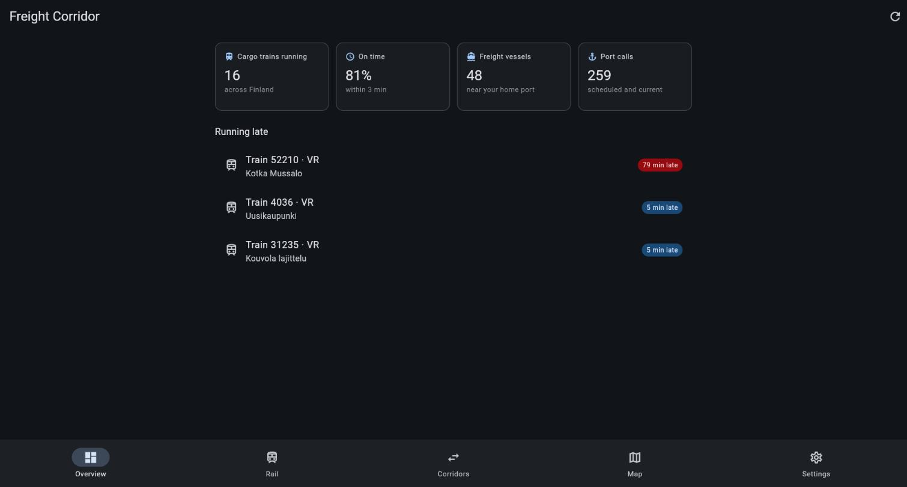
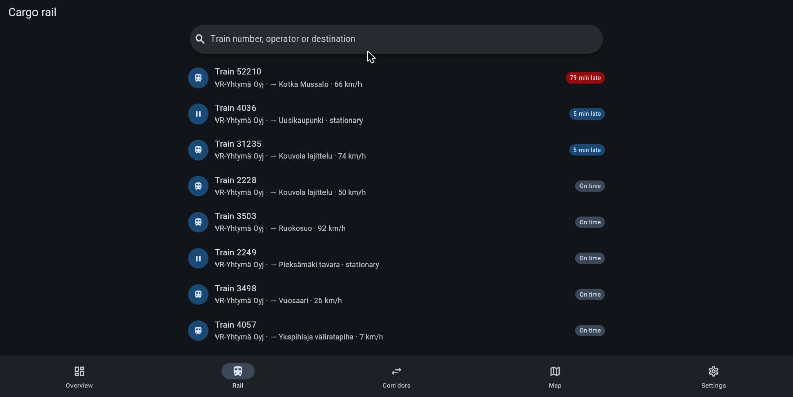
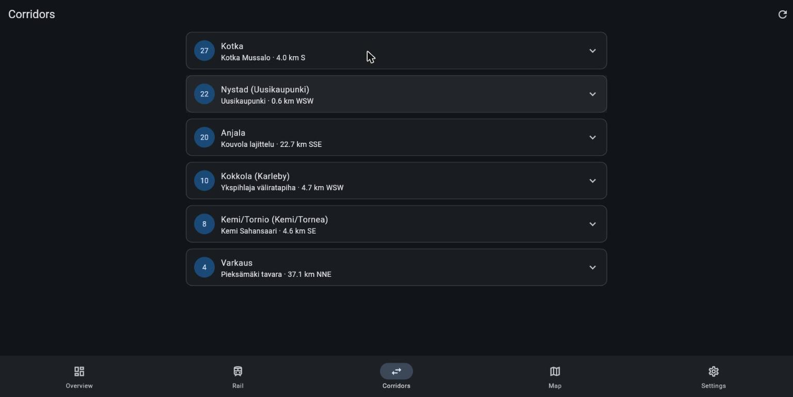
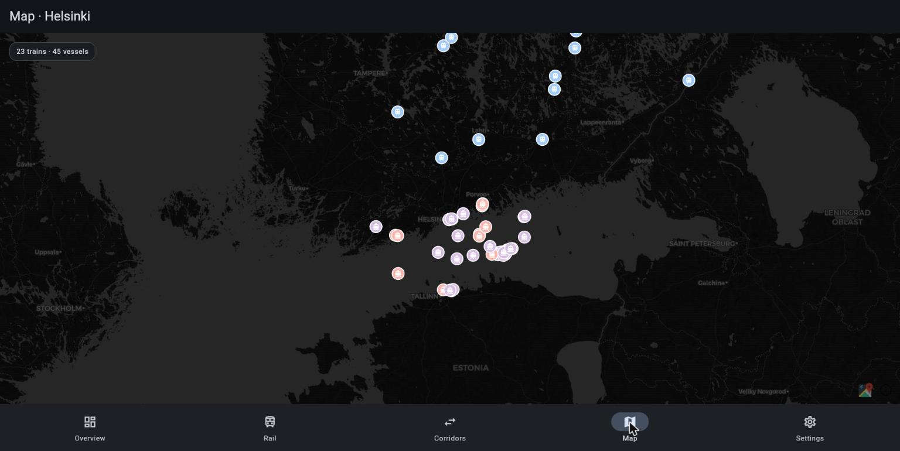
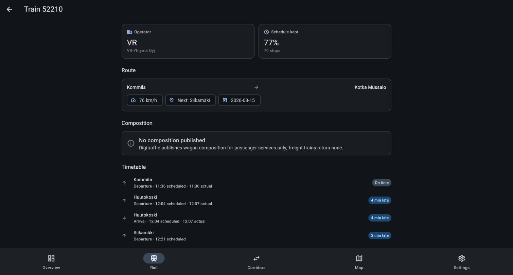
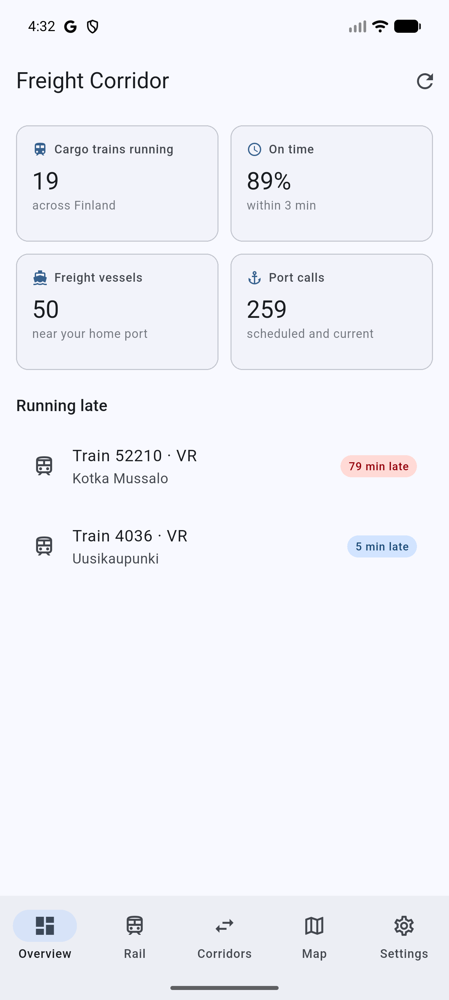
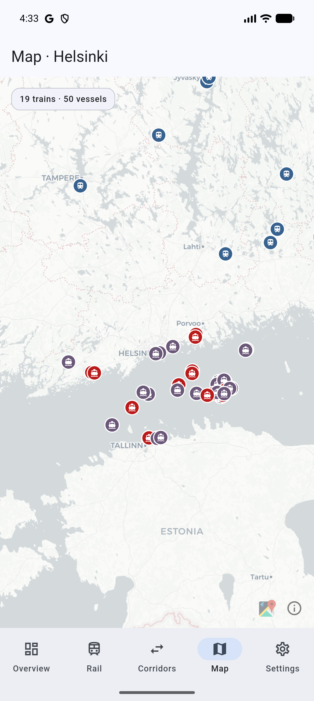
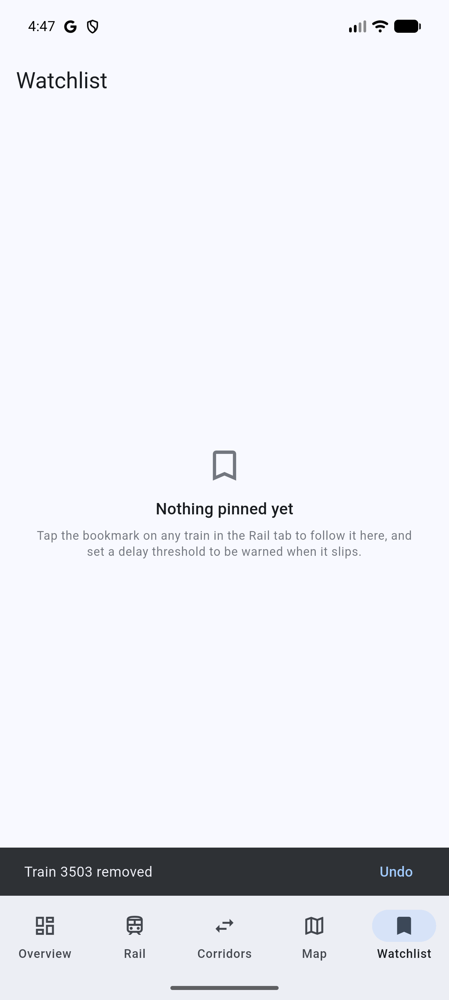

# Flutter Freight Corridor

A Flutter app for Android and the web that shows live Finnish freight traffic. It reads cargo
trains from the Digitraffic railway GraphQL API and vessels and port calls from the Digitraffic
marine REST API, then pairs each rail terminus with the nearest seaport to show where freight
moves from rail to sea.

[Live demo](https://calemccammon.github.io/flutter-freight-corridor/) (the web build, deployed to
GitHub Pages on every push to `main`). The data is open and needs no API key or account.

## Screens

| Overview | Cargo rail |
|---|---|
|  |  |

| Corridors | Map |
|---|---|
|  |  |

| Train detail |
|---|
|  |

The same source on Android in the light theme. The web screenshots above use the dark theme, and
both palettes come from one `ColorScheme.fromSeed`.

<p align="center">
  
  
  
</p>

The app has five tabs and two pushed screens.

| Screen | Route | Content |
|---|---|---|
| Overview | `/` | Counts of running cargo trains, freight vessels and port calls, the on-time share, and the trains currently running late |
| Rail | `/rail` | Cargo trains sorted by worst delay, with a text filter on train number, operator and terminus |
| Train detail | `/rail/:trainNumber/:departureDate` | Route, schedule adherence and timetable for one train |
| Corridors | `/corridors` | Rail termini paired with seaports, ordered by activity |
| Map | `/map` | Train and vessel positions around a chosen home port |
| Watchlist | `/watchlist` | Pinned trains and vessels, with a delay threshold |
| Settings | `/settings` | Home port, search radius, refresh interval, theme, alerts service connection, data licence |

The web build uses Flutter's default hash URL strategy, so a deep link has the form
`https://calemccammon.github.io/flutter-freight-corridor/#/corridors`.

## Getting started

The project is pinned to Flutter 3.47 and Dart 3.13 (CI uses Flutter 3.47.0).

```bash
# 1. Install Flutter 3.47 (https://docs.flutter.dev/get-started/install)
flutter --version

# 2. From the repository root. One pub get resolves both workspace packages.
flutter pub get

# 3. Generate the GraphQL types. They are not committed (see Design decisions).
cd app
dart run build_runner build

# 4. Run. There is no API key and no .env file.
flutter run -d chrome      # or: flutter run -d <android-device>
```

Tests:

```bash
# Domain logic only. Plain Dart, no Flutter and no network.
cd packages/freight_core && dart test

# App tests. Run the code generation step first. All external calls are mocked.
cd app && flutter test

# Optional: call the live APIs through the data layer and print what came back.
cd app && dart run tool/smoke.dart
```

If the Android build fails with `Unresolved reference 'plugins'` in `settings.gradle.kts`, check
whether `GRADLE_USER_HOME` sits behind a symlink or junction. This was seen with a Scoop-installed
Gradle on Windows, where the default is `scoop\apps\gradle\current\.gradle` and `current` is a
junction. Pointing `GRADLE_USER_HOME` at a real directory fixed it. The web build and the tests do
not use Gradle.

## Architecture

```
   rata.digitraffic.fi/api/v2/graphql        meri.digitraffic.fi/api/...
              (GraphQL)                               (REST)
                  │                                     │
          RailDataSource                        MarineDataSource
       ferry + generated types              package:http + SnapshotStore
                  │                                     │
                  └──────────────┬──────────────────────┘
                                 │
                       FreightRepository
              returns only freight_core models
                     one exception type
                                 │
                  ┌──────────────┴──────────────┐
                  │                             │
        Riverpod providers            packages/freight_core
     Future / Stream / Notifier       pure Dart, no Flutter
                  │                  models · geo · AIS codes
                  │                  schedule · corridor_linker
             AsyncValue<T>                       ▲
                  │                              │
            AsyncValueView ───── widgets ────────┘
                  │
        go_router shell · 5 tabs · Android + Web
```

The repository is a pub workspace with two packages and one lockfile.

`packages/freight_core` holds the models and the domain rules. It depends only on `meta` and
`collection` and imports nothing from Flutter, so its tests run with `dart test`.

`app` holds the data layer, the Riverpod providers and the screens. `RailDataSource` maps ferry's
generated types to `freight_core` models. `MarineDataSource` does the same for the REST payloads.
`FreightRepository` wraps both, returns only `freight_core` types, and converts every failure into
a single `FreightException`. Providers and widgets therefore have no dependency on ferry or
`package:http`.

Each screen renders loading, error, empty and data states through one widget, `AsyncValueView`,
which keeps the previous data on screen while a refresh is in flight.

```
flutter-freight-corridor/
├── pubspec.yaml                     # pub workspace root, one lockfile for both packages
├── analysis_options.yaml            # shared lints, strict-casts, strict-raw-types
│
├── packages/freight_core/
│   ├── lib/src/models/              # geo_point, freight_train, vessel, port, port_call, corridor
│   └── lib/src/logic/
│       ├── geo.dart                 # haversine, bearing, mean bearing, compass
│       ├── ais_codes.dart           # ITU ship types, navigation status, bit-packed ETA
│       ├── schedule.dart            # delay buckets, adherence, travel time
│       ├── geojson.dart             # AIS and port directory parsing
│       └── corridor_linker.dart     # the rail to sea join
│
└── app/
    ├── build.yaml                   # ferry codegen config, Date/DateTime mapped to String
    ├── lib/data/
    │   ├── graphql/schema.graphql   # committed, so codegen never needs the live endpoint
    │   ├── graphql/cargo_trains.graphql
    │   ├── rail_data_source.dart    # ferry to freight_core
    │   ├── marine_data_source.dart  # http to freight_core, with snapshot fallback
    │   ├── digitraffic_headers*.dart# conditional import, VM and browser variants
    │   ├── snapshot_store.dart      # storage interface for last-known-good payloads
    │   ├── alerts_client.dart       # client for the freight-alerts service
    │   └── freight_repository.dart
    ├── lib/providers/               # Riverpod providers, written by hand
    ├── lib/screens/
    ├── lib/widgets/
    └── tool/smoke.dart              # calls the live APIs and prints results
```

| Layer | Tool |
|---|---|
| Framework | Flutter 3.47, Dart 3.13 |
| State | flutter_riverpod 3.4 (`FutureProvider`, `StreamProvider`, `Notifier`) |
| Routing | go_router 17, `StatefulShellRoute` |
| GraphQL | ferry 0.16 with `ferry_generator`, schema committed |
| REST | `package:http` |
| Maps | flutter_map 8 with CARTO basemaps |
| Persistence | `shared_preferences` behind a `SnapshotStore` interface |
| Tests | `dart test`, `flutter_test`, `mocktail`, `MockClient`, a fake ferry `Link` |
| CI | GitHub Actions: format, codegen, analyze, test, web build, debug APK, deploy to Pages |

## Data sources

All data comes from [Fintraffic Digitraffic](https://www.digitraffic.fi/en/).

| Feed | Endpoint |
|---|---|
| Cargo trains (GraphQL) | `rata.digitraffic.fi/api/v2/graphql/graphql`, query `currentlyRunningTrains` filtered to train category `Cargo` |
| Train detail and wagon composition | same endpoint, query `train(trainNumber, departureDate)` with `compositions { journeySections { wagons locomotives } }` |
| Vessel positions (AIS) | `meri.digitraffic.fi/api/ais/v1/locations` |
| Vessel details | `meri.digitraffic.fi/api/ais/v1/vessels` |
| Port calls | `meri.digitraffic.fi/api/port-call/v1/port-calls` |
| Port directory | `meri.digitraffic.fi/api/port-call/v1/ports` |

Every request sends a `Digitraffic-User` header that identifies the client, as Digitraffic's usage
instructions ask.

### Findings about the upstream API

These were found by querying the API and are handled in one place each.

**`Accept-Encoding: gzip` is required.** Digitraffic answers `406 Not Acceptable` without it. The
header is set explicitly on the Dart VM. In a browser it is a forbidden header name that the
browser sets itself, so the web build omits it. A conditional import
(`digitraffic_headers.dart`) selects the right header set at compile time.

**Coordinates are `[longitude, latitude]`.** Both APIs use this order. `GeoPoint.fromLonLat` is
the only place that reads a coordinate pair, and it returns null for a malformed or out-of-range
pair.

**The AIS `timestamp` property is the second of the minute.** `properties.timestamp` in the
`locations` feed holds a value from 0 to 59. The time of the report is `timestampExternal`, in
epoch milliseconds. `parseVesselPositions` in `geojson.dart` reads `timestampExternal`, and a test
covers the difference.

**Cargo intent has to be derived.** The port-call feed exposes `arrivalWithCargo`, `notLoading`
and `discharge` without a field that says what the vessel is there to do. `CargoIntent.from`
turns them into one of loading, discharging, both, in ballast or unknown.

**The port directory is the worldwide UN/LOCODE list.** The `ports` endpoint returns about 18,600
places, of which about 170 are Finnish entries with coordinates. Many of those are inland places
that no ship visits. The app trims the response to Finnish entries with coordinates before caching
it, and the corridor view further narrows the set to LOCODEs that appear in the port-call feed.

**Wagon composition is empty for cargo trains.** The schema exposes `compositions` on every
`Train`, with wagon counts, lengths and locomotive types. When this was checked in August 2026,
0 of 18 running cargo trains returned a composition, while a sample of passenger services returned
5 to 12 wagons each. The mapping code and its tests are kept because the field is populated for
other train categories. The train detail screen shows a "No composition published" card for cargo
trains.

## Design decisions

### Joining rail and sea by distance

The rail API and the marine API share no identifier. `linkCorridors` in `freight_core` joins them
geographically. It takes the last station on each cargo train's timetable, finds the nearest
Finnish seaport within 60 km, and attaches the vessels within 60 km of that port and the port
calls expected there in the next 24 hours. Corridors are ordered by a weighted count of trains,
port calls and vessels (weights 3, 2 and 1). The weights are a judgement used only for ordering.

The function takes plain lists and a `now` argument, so its tests need no network and no clock.

### Generated code is not committed

`ferry_generator` emits built_value types and serializers for the whole Digitraffic schema (129
type definitions), whatever the queries select. When it was measured, two queries produced 49,155
lines across 12 files (1.4 MB), roughly ten times the hand-written source. The output is
gitignored and regenerated in CI from the committed `schema.graphql`.

This sets the CI step order. Formatting is checked before code generation, while only
hand-written files exist. Analysis runs after it, because the data source imports generated types.

### Riverpod providers are written by hand

`riverpod_generator` 4.0.6 and later requires `analyzer ^13.0.0`, and every published
`ferry_generator` caps `analyzer` below 13. The two generators cannot resolve together. The
project keeps ferry's generator for typed GraphQL and declares providers explicitly.
`riverpod_lint` and `custom_lint` are absent for a similar version conflict.

### GraphQL scalars are mapped to strings

`build.yaml` maps the schema's `Date` and `DateTime` scalars to `String`. The data source parses
them, so the generated layer needs no custom serializers and a malformed timestamp yields null
instead of failing the response.

### Snapshot fallback for the marine feeds

`MarineDataSource` writes each successful REST response to a `SnapshotStore`. When a later request
fails with the same query, it returns the stored payload and records when it was captured, and the map shows an
"Offline" banner with that time. The store is an interface so that the data layer does not import
`shared_preferences`. `shared_preferences` was chosen over a database because the payloads are
replaced on every refresh and are never queried, and on the web it needs no extra assets.

### Polling instead of MQTT

Digitraffic also offers MQTT over WebSocket. The map polls instead, every 20 seconds by default
(10, 20 or 60 seconds in Settings). Polling avoids reconnect and backoff handling and separate
server and browser MQTT clients. Each poll makes two requests, one for positions and one for
vessel details.

### Widget state and application state

Most screens are `ConsumerWidget`s over Riverpod providers. `AlertThresholdForm` in the watchlist
and the alerts service section in Settings are stateful widgets, because they own
`TextEditingController`s and a `FocusNode` whose lifetime is the widget's. The validation rules
(`Watchlist.validateAlertMinutes`, `AlertsClient.validateBaseUrl`) are static functions with their
own unit tests.

### CARTO basemap

The map uses CARTO tiles instead of OpenStreetMap's tile servers. OSM's usage policy requires an
identifying User-Agent, which a browser does not let the app set. CARTO also has a dark variant
that follows the app theme.

## Watchlist and the alerts service

Trains are pinned with the bookmark button on the Rail list and the train detail screen. The
watchlist stores ids in `shared_preferences` and resolves them against the live feed, so a train
that has finished its run drops out of the list. The watchlist model and screen also handle
vessels, but no screen has a control for pinning one yet. A banner appears when a watched train's
worst delay reaches the threshold (15 minutes by default, 1 to 240 allowed). Swiping a row removes
the pin and offers an undo.

The watchlist is local to the device and is only evaluated while the app is open.
[`freight-alerts`](https://github.com/calemccammon/freight-alerts) is a separate Go service that
holds watch rules server-side and polls Digitraffic on a schedule. Under Settings, "Alerts
service" takes the service URL and a device token, checks them, and can then register every watched
train as a server-side rule.

- The app authenticates with a bearer token issued by the service. The settings screen calls
  `GET /api/me` to check the connection and `POST /api/rules` to register a train.
- `AlertsClient` can also read the service's recorded alerts (`GET /api/alerts`) and rules
  (`GET /api/rules`). No screen displays them yet.
- A local pin is `trainNumber/departureDate`. A server rule is keyed on the train number alone, so
  two pins for the same train on different dates become one rule.
- The service handles trains only. Watched vessels are counted and reported as skipped.
- The token is stored in `shared_preferences`, not in a platform keystore.

## Testing

There are 122 test cases: 52 in `freight_core` and 70 in the app. No test uses the network.

| Test file | What it covers |
|---|---|
| `geo_test` | Haversine against the Helsinki to Tampere distance, bearing and 16-point compass, circular mean of bearings across north, `[lon, lat]` ordering |
| `ais_codes_test` | ITU ship-type bands (70 to 79 cargo, 80 to 89 tanker), AIS bit-packed ETA decoding including sentinels and year rollover, length and beam from reference points |
| `schedule_test` | Delay buckets at their boundaries, worst delay ignoring early running, adherence returning null for an empty sample, no travel time for a stationary train |
| `geojson_test` | `timestampExternal` is used instead of the AIS second-of-minute field, malformed features are skipped |
| `corridor_linker_test` | Terminus pairs with the nearest seaport in radius, foreign ports and out-of-range termini are excluded, corridors are ordered by traffic, cargo intent, wagon composition totals |
| `rail_data_source_test` | A ferry client over a fake `Link` runs the generated deserializers and maps the result onto models, so the schema, the query and the mapping are checked together. |
| `marine_data_source_test` | Headers and query parameters, UTF-8 decoding of Finnish names, snapshot fallback when the network fails, no fallback to a snapshot taken for a different query, port directory trimmed before caching and reused, non-200 handling |
| `freight_repository_test` | Rail and marine failures become `FreightException`, non-freight vessels are dropped, LOCODEs with no port call are excluded |
| `widgets_test` | `AsyncValueView` renders its four states, delay chips label each bucket, the rail list sorts and filters, failures offer a retry |
| `watchlist_test` | Threshold validation and clamping, pins persist and rehydrate, pins resolve against the live feed, alerts fire at the threshold, swipe removes a row and offers undo, an invalid threshold does not overwrite the stored value |
| `alerts_client_test` | URL and token validation, bearer header, 401 handling, feed parsing, UTF-8 decoding, service error messages, transport failures |
| `alerts_sync_test` | Train number sent without the departure date, duplicate train numbers registered once, vessels counted as skipped, a rejected rule reports the service message, connection settings stored and cleared |

CI runs formatting, code generation, `flutter analyze`, both test suites, a release web build and
a debug Android APK build on every push. The Pages deployment runs the app tests first.

## Limitations

- Only the vessel positions on the map are polled. Trains, port calls and corridors refresh on
  pull-to-refresh, the refresh button or a retry.
- The rail side has no offline fallback. Only the marine REST responses are stored as snapshots.
- One snapshot is kept per endpoint, and it is served only to a request with the same query. After
  the home port or radius changes, there is no offline fallback for vessel positions until the
  next successful fetch.
- The corridor pairing is a distance heuristic. It does not know whether a train's cargo is bound
  for the port it is paired with.
- The map draws at most 150 vessel markers.
- Wagon composition is not available for cargo trains (see above).
- The watchlist does not notify. Alerts appear as a banner inside the app while it is open.
- Vessels cannot be pinned from the UI, and alerts recorded by the alerts service are not shown.
- CI builds a debug APK only. The Android release build type has no signing configuration of its
  own and signs with the debug key.

## Data attribution

The data is from [Fintraffic Digitraffic](https://www.digitraffic.fi/en/) and is licensed under
[CC BY 4.0](https://creativecommons.org/licenses/by/4.0/). The app modifies it: delays are
classified into bands, and corridors are derived by linking a train's terminus to a nearby port.
The licence, the source and this note are shown in the app under Settings and in the map
attribution. Map tiles are from CARTO, based on OpenStreetMap data.
